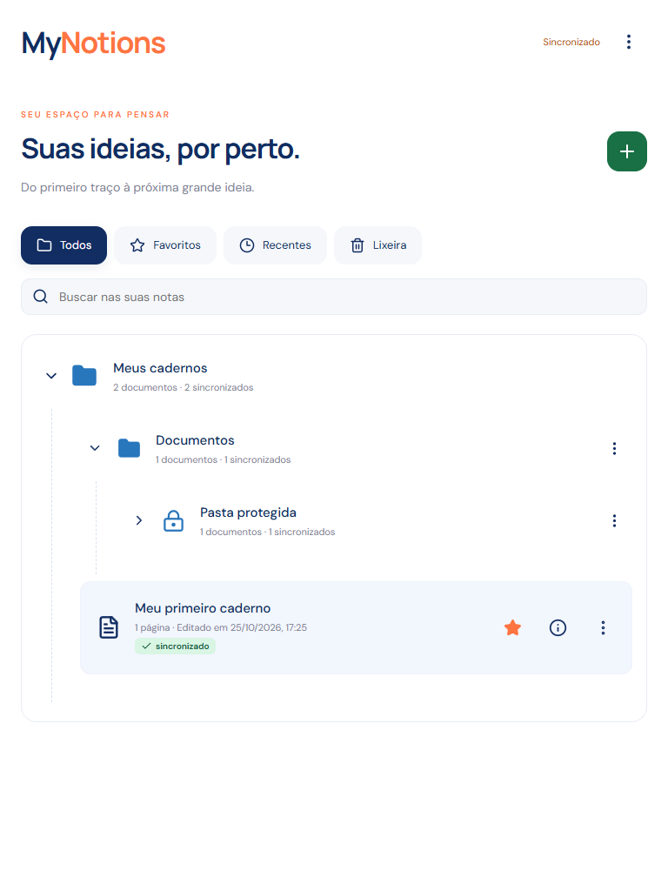
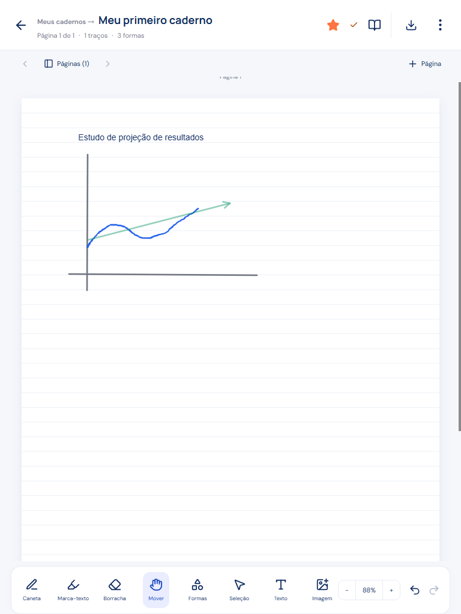
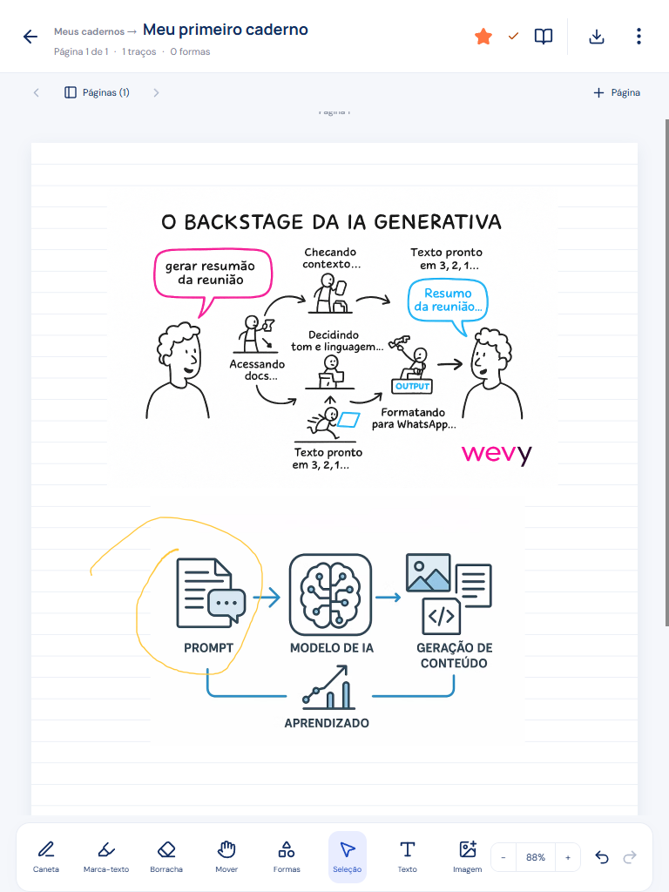
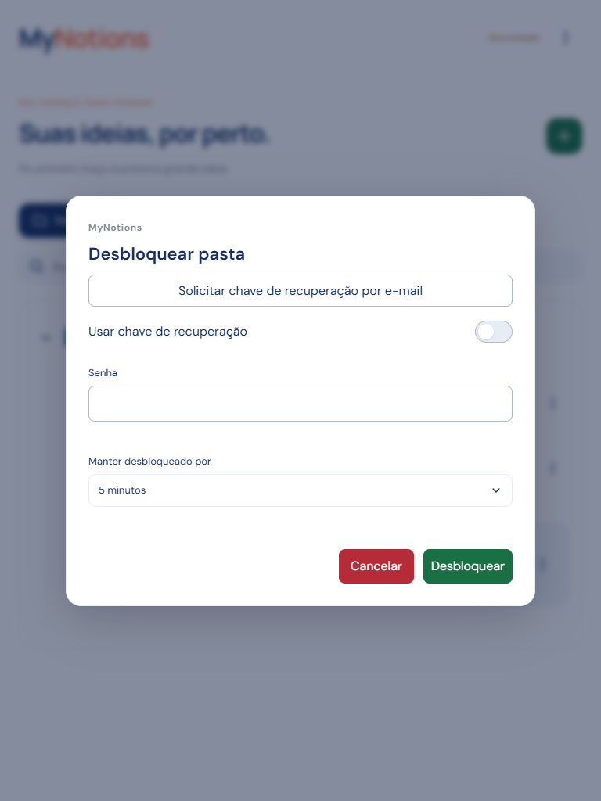

# Quem Somos

**Suas ideias, por perto.**

O MyNotions nasceu para reunir a liberdade de escrever à mão e a praticidade das notas digitais em um só lugar. Um espaço para estudar, planejar, desenhar e organizar o que importa — do primeiro rabisco a um caderno inteiro de conhecimento.

Criado por **Davi Marino**, o aplicativo coloca o tablet no centro da experiência: pegue sua caneta, abra uma página e dê forma às suas ideias. Combine escrita, texto, imagens e PDFs no mesmo caderno, com uma interface que deixa espaço para o seu conteúdo.

## Instalação

Baixe o APK Android na [página de versões do MyNotions](https://github.com/DaviMarino/mynotions-app/releases).

1. Abra a versão desejada e baixe o arquivo **MyNotions-…-android.apk**.
2. Abra o arquivo no seu tablet ou celular Android.
3. Se o Android solicitar, autorize a instalação pelo aplicativo usado para abrir o APK e conclua a instalação.
4. Abra o MyNotions e comece seu primeiro caderno.

Você pode começar sem criar uma conta e usar seus cadernos offline. Para levar suas anotações entre dispositivos, crie uma conta e ative a sincronização.

[Ver versões disponíveis e baixar](https://github.com/DaviMarino/mynotions-app/releases)

## Descrição do aplicativo e funcionalidades

### Um caderno para cada ideia

Crie cadernos com várias páginas e escolha o fundo que combina com seu jeito de trabalhar: liso, pautado, quadriculado ou pontilhado. Use o zoom para cuidar dos detalhes e o modo de leitura para apresentar seu conteúdo com um ponteiro laser.

  

### Escreva, desenhe e transforme

Alterne entre caneta, marca-texto, borracha e texto. Ajuste cores e espessuras, crie formas e setas e escolha traços contínuos, tracejados ou pontilhados. Selecione elementos para mover, redimensionar, girar e reorganizar suas ideias na página.

Para quem também gosta de digitar, os blocos de texto oferecem formatação Markdown, títulos, listas e destaques. Escrita à mão e teclado se complementam no mesmo espaço.

  

### Suas referências fazem parte do caderno

Insira imagens e abra PDFs para fazer suas próprias anotações sobre o material. Reúna explicações, esquemas e referências em um lugar só — para acompanhar uma aula, revisar um projeto ou registrar uma ideia com contexto.

  

### Organização que acompanha seu raciocínio

Distribua seus cadernos em pastas e subpastas, personalize as cores das pastas e marque seus favoritos. Adicione descrição, tags e propriedades de chave e valor para dar contexto aos documentos.

A busca encontra cadernos pelo nome e pelos metadados. As informações de cada documento ficam a um toque de distância, com uma prévia do conteúdo para ajudar a reconhecer o que você procura.

### Continue de onde parou

Suas anotações são salvas no dispositivo para você continuar trabalhando offline. Com uma conta, sincronize seus cadernos e acompanhe as alterações entre dispositivos conectados.

Gerencie até três contas no mesmo dispositivo, com espaços separados para suas notas. Exporte seus cadernos para guardar uma cópia ou importá-los novamente quando precisar.

### Mais controle sobre conteúdos pessoais

Proteja documentos, pastas e subpastas com senha. Personalize a senha de conteúdos específicos e escolha por quanto tempo eles ficam desbloqueados durante o trabalho.

O aplicativo avisa antes do bloqueio e permite renovar o tempo de acesso. Dispositivos confiáveis, confirmação por e-mail e recuperação por e-mail complementam o gerenciamento do acesso aos conteúdos protegidos.

  

## Atualizações

Acompanhe as novidades e baixe os APKs na [página de versões](https://github.com/DaviMarino/mynotions-app/releases). Cada publicação reúne as mudanças da versão e os arquivos para instalação.

Para atualizar, baixe o novo APK e instale-o sobre a versão pública que você já utiliza. Mantenha o aplicativo instalado durante esse processo para preservar seus dados locais.

Sua experiência ajuda a construir o MyNotions. Compartilhe sugestões e relate problemas nas [Issues da comunidade](https://github.com/DaviMarino/mynotions-app/issues), contando o que aconteceu e qual dispositivo você utiliza. Ao enviar imagens, preserve seus dados pessoais.
